# Janus background fits

Tests of the Janus cosmological model (Petit & D'Agostini) against late-universe data:
cosmic chronometers, DESI DR2 BAO, two supernova samples, SH0ES-calibrated supernovae and
redshift-space-distortion growth measurements. All fits are compared with flat ΛCDM on the same
data with the same number of free parameters. No early-universe assumptions are made anywhere:
the BAO sound horizon $r_d$ and the supernova absolute magnitude are left free, so only the
*shape* of the expansion history is tested.

**In one paragraph.** The Janus expansion law $H(z) = H_0(1+z)\sqrt{1+2q_0 z}$, derived from the
authors' own equations, is rejected by DESI DR2 BAO and by two independent supernova samples at
$\Delta\chi^2 \approx 317$ relative to flat ΛCDM with equal parameter counts. The published
$q_0 = -0.087$ is excluded by supernovae alone at $\approx 4.7\sigma$ in each sample and by BAO alone
overwhelmingly; the supernova and BAO windows on $q_0$ do not overlap, whereas the same data agree
under ΛCDM. No negative-density twin sector of any equation of state fits. The model's
structure-formation mechanism survives growth data at $\approx 2\sigma$, but only in a $q_0$ window
the expansion data forbid. Every number can be rerun from this repository.

Companion projects: N-body simulations of the Janus twin-matter dynamics (simulation repository), and
[skua](https://github.com/CosmoTheoretician/skua), which carries the test rig forward to the question
of what the same data say about evolving dark energy.

## The model being tested

The Janus dust-era exact solution is $a(u) = \alpha^2 \cosh^2 u$ on an open ($k = -1$) universe
(D'Agostini & Petit 2018; same form in the 2019 and 2024 papers). From it,

$$H(z) = H_0\,(1+z)\sqrt{1 + 2 q_0 z}, \qquad \Omega_m = 2 q_0, \qquad \Omega_k = 1 - 2 q_0,$$

with the published value $q_0 = -0.087 \pm 0.015$. This is verified analytically here against the
authors' own distance formula $r = \sinh(2u_0 - 2u_e)$ (eq. 22 of D'Agostini & Petit 2018), so the
fits test the model exactly as its authors define it. The solution is defined only for
$1 + 2q_0 z > 0$, i.e. $z < 1/(2|q_0|)$ when $q_0 < 0$ ($z = 5.75$ for the published value); the
scale factor reaches a minimum there, and the model assigns earlier epochs to a separate
radiative-era solution that is not tested here.

**Why the test does not ignore the bimetric structure.** In the authors' own construction the
two sectors have separate FLRW metrics with scale factors $a$ and $\bar a$, coupled through the
ratio of metric determinants $(\bar a/a)^3$; compatibility of the resulting equations gives
their generalised conservation law $\rho c^2 a^3 + \bar\rho\,\bar c^2\,\bar a^3 = E = \text{const}$
(Petit, Margnat & Zejli 2024, eq. 96; the cross-coupling appears as $(a^{(-)}/a^{(+)})^3$ in eq. 1 of
D'Agostini & Petit 2018, whose eq. 22 is the distance–redshift relation used here). The twin density
therefore enters *our* Friedmann equation as $E/a^3$: a matter-like term with total energy $E$,
independent of $\bar a(t)$, and the additive form above is the unique dust-era consequence of the
coupling, not a simplification made here. A non-dust twin sector ($\bar w \neq 0$) can change the time
dependence of the twin contribution through $\bar a(t)$, but never its sign, which is the sign of
$\bar\rho$; that whole family is covered by the negative-density row of the closure test below.

Note that the Janus background is mathematically identical to a universe containing only
matter and curvature with no cosmological constant and a matter density allowed to be
negative. Fitting Janus with $q_0$ free therefore tests that entire family.

## Scripts

| script | data | what it does |
|---|---|---|
| `cc_fit.py` | 15 cosmic chronometers | H(z) fit, Janus / ΛCDM / Milne, $q_0$ profile |
| `bao_fit.py` | DESI DR2 BAO (13 points) | $D_M/r_d$, $D_H/r_d$, $D_V/r_d$ with $r_d$ free; only $c/(H_0 r_d)$ is constrained |
| `sn_fit.py` | Pantheon+ (1590 SNe, z > 0.01) | full STAT+SYS covariance, magnitude marginalised |
| `des_fit.py` | DES-SN5YR Dovekie (1820 SNe) | same method, inverse covariance from DES release |
| `likelihoods.py` | all of the above | shared likelihood module |
| `combined_fit.py [des]` | CC + BAO + SN | best fits, AIC/BIC, emcee posteriors, corner plots; Janus, flat ΛCDM, oΛCDM |
| `premise_test.py` | CC + BAO + SN | $\Delta\chi^2$ of $q_0 = 0$ and $q_0 = -0.087$ within the Janus model |
| `h0_test.py` | Pantheon+ with SH0ES Cepheid calibrators | absolute $H_0$; cost of combining with BAO + CC |
| `growth_fit.py` | 22 fσ8 points (Gold 2018) | two-fluid linear growth, σ8 marginalised |
| `growth_fixed_amp.py` | same | σ8 with a weak-lensing-style prior 0.78 ± 0.05 |
| `first_galaxies.py` | — | cosmic ages, start of the Janus dust era vs JWST galaxies |
| `q0_map.py` | — | allowed $q_0$ window from every test on one axis |
| `redshift_drift.py` | — | predicted redshift drift for ELT/ANDES |
| `sirens.py` | — | siren $H_0$ vs fitted $H_0$; $D_L(z)$ forecast for Einstein Telescope / Cosmic Explorer |
| `nbody_growth_check.py` | companion N-body run | growth of the lowest box modes vs linear two-fluid theory, no free parameters |
| `twin_eos_fit.py [des]` | CC + BAO + SN | closure test: baryons only + curvature + twin sector of free density and CPL $w(a)$ |

Outputs (tables and plots) are in `results/`.

### Reproducing

Python ≥ 3.10 with numpy, scipy, matplotlib, emcee, corner, tqdm.

    mkdir -p data && cd data
    wget https://raw.githubusercontent.com/PantheonPlusSH0ES/DataRelease/main/Pantheon%2B_Data/4_DISTANCES_AND_COVAR/Pantheon%2BSH0ES.dat
    wget https://raw.githubusercontent.com/PantheonPlusSH0ES/DataRelease/main/Pantheon%2B_Data/4_DISTANCES_AND_COVAR/Pantheon%2BSH0ES_STAT%2BSYS.cov
    git clone --depth 1 --filter=blob:none --sparse https://github.com/des-science/DES-SN5YR.git des_repo
    (cd des_repo && git sparse-checkout set 4_DISTANCES_COVMAT)
    cd ..
    for s in cc_fit bao_fit sn_fit des_fit premise_test h0_test growth_fit growth_fixed_amp first_galaxies q0_map redshift_drift sirens twin_eos_fit; do python $s.py; done
    python combined_fit.py; python combined_fit.py des

The chronometer and BAO tables are embedded in the scripts. The combined fits take a few
minutes each (MCMC over the full supernova covariance).

### Validation

Every likelihood reproduces a published ΛCDM result before being applied to Janus:

| test | this pipeline | published |
|---|---|---|
| DESI DR2 BAO, flat ΛCDM | Ω_m = 0.297, H0·r_d ≈ 10 150 km/s | Ω_m ≈ 0.2975, h·r_d ≈ 101.5 Mpc |
| Pantheon+, flat ΛCDM | Ω_m = 0.332 | ≈ 0.33 |
| DES-SN5YR Dovekie, flat ΛCDM | Ω_m = 0.330 | ≈ 0.30–0.35 |
| Combined, flat ΛCDM, r_d free | r_d = 148.2 ± 4.1 Mpc with no CMB input | ≈ 147 Mpc from CMB physics |
| Pantheon+ with SH0ES calibrators | H0 = 73.5 | 73.6 (SH0ES) |
| Gold fσ8, flat ΛCDM | Ω_m = 0.256, σ8 = 0.80, χ² = 12.2/20 | the usual growth-only values |
| Age of a flat ΛCDM universe | 13.79 Gyr; 0.29 Gyr at z = 14.2 | 13.8 Gyr |

## Results

### Expansion history

| data | Δχ² (best Janus − best flat ΛCDM), equal parameters | best Janus q0 | Petit's q0 = −0.087 |
|---|---|---|---|
| Cosmic chronometers (15) | +1.6 | 0.005 (−0.075 to 0.100) | Δχ² +1.3 from best |
| DESI DR2 BAO (13), r_d free | **+221** | +0.101 (0.098 to 0.104) | χ² = 2389 (Δ +2158) |
| Pantheon+ (1590) | **+46.5** | −0.022 (−0.034 to −0.008) | Δ +22.6 (≈ 4.7σ) |
| DES-SN5YR (1820) | **+29.3** | −0.027 (−0.040 to −0.015) | Δ +22.8 (≈ 4.7σ) |
| Combined CC+BAO+Pantheon+ | **+316.6** | +0.085 ± 0.006, H0 = 58.9 ± 1.6, r_d = 154.5 ± 4.3 | Δ +2131 |
| Combined CC+BAO+DES | **+317.1** | +0.081 ± 0.006, H0 = 59.0 ± 1.6, r_d = 154.7 ± 4.3 | — |

- Within the Janus model itself, $q_0 = 0$ (zero net mass) is excluded at Δχ² = 305 and the
  published $q_0 = -0.087$ at Δχ² = 2131 (nested one-parameter tests; see the Conclusions for
  how to read these numbers). The only Janus background the data tolerate at all is
  *decelerating*, with positive net mass Ω_m = 2q0 ≈ 0.17, more than three times the baryon
  density; i.e. it would require dark matter, which the model exists to remove.
- Under Janus the datasets disagree with each other (supernovae want $q_0 \approx -0.02$, BAO wants
  $+0.10$). Under ΛCDM the same datasets agree.
- With curvature and Λ both free (oΛCDM), the data require Ω_Λ = 0.66 ± 0.03 and near-flatness;
  curvature does not substitute for dark energy.
- SH0ES-calibrated supernovae give H0 ≈ 72–73 in both models; reconciling that with BAO + CC
  costs χ² = 26.5 in ΛCDM (the known Hubble tension) and 334 in Janus.

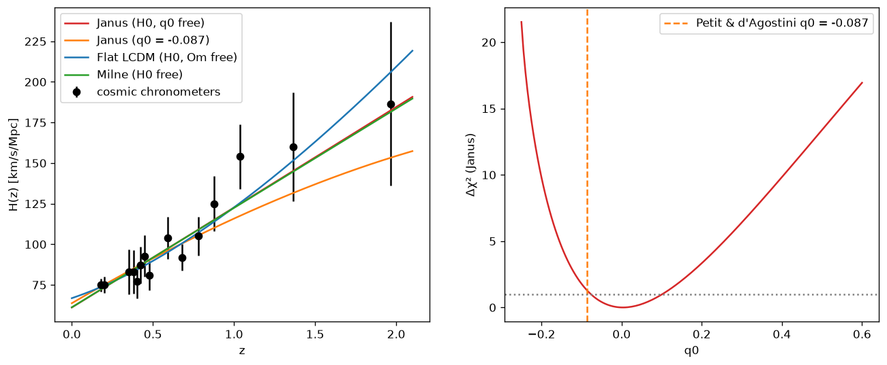
*Cosmic chronometers: H(z) with the four models (left); Janus χ² profile in q0 (right)*

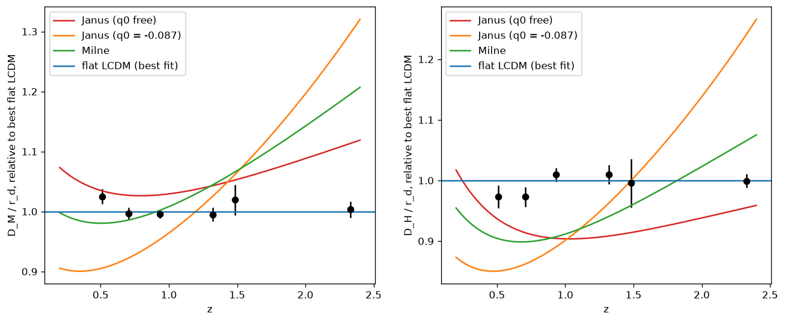
*DESI DR2 BAO: D_M/r_d and D_H/r_d relative to best flat ΛCDM, with Janus and Milne*

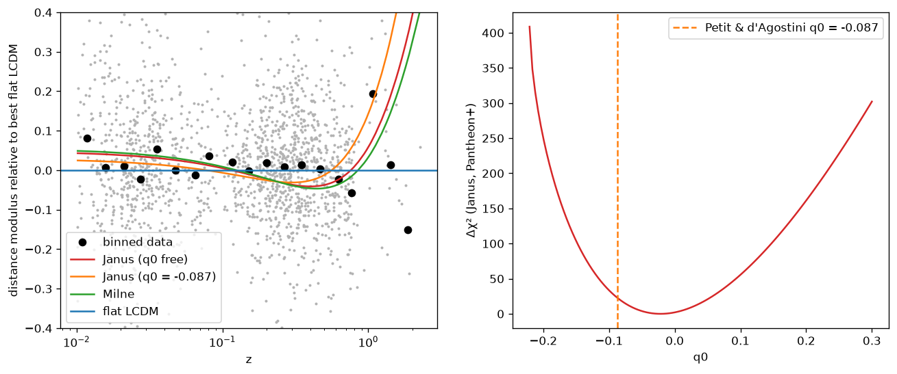
*Pantheon+: residuals relative to best flat ΛCDM (left); Janus q0 profile (right)*

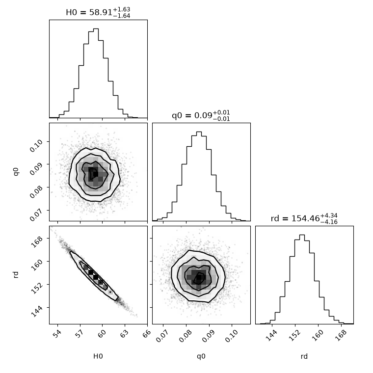
*Combined CC + BAO + Pantheon+: Janus posterior*

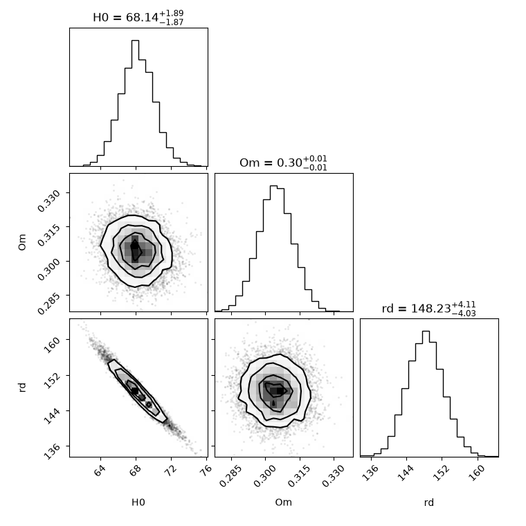
*Combined CC + BAO + Pantheon+: flat ΛCDM posterior*

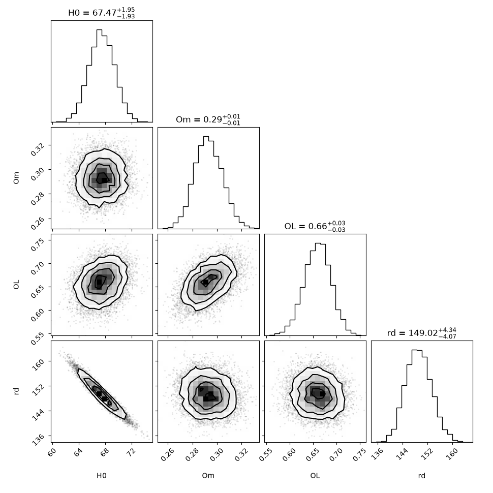
*Combined CC + BAO + Pantheon+: oΛCDM posterior*

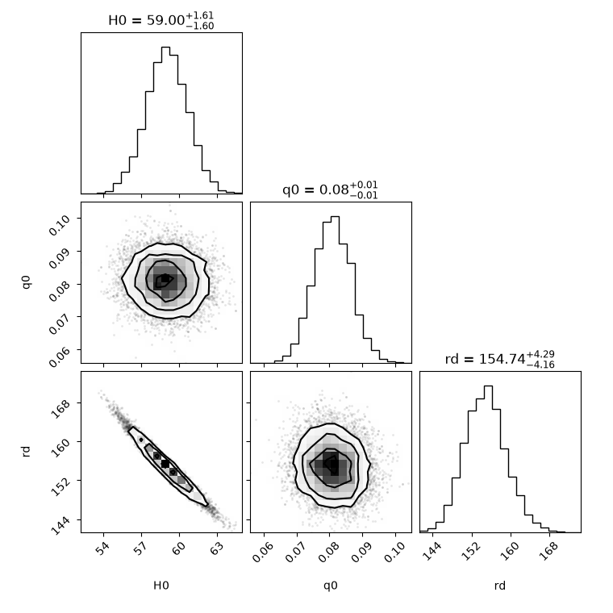
*Combined CC + BAO + DES-SN5YR: Janus posterior*

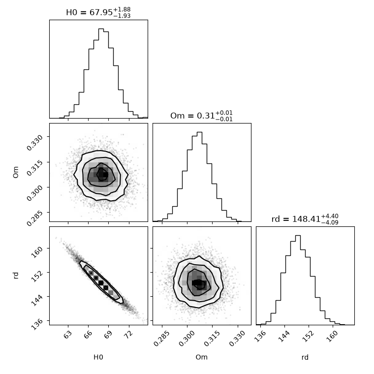
*Combined CC + BAO + DES-SN5YR: flat ΛCDM posterior*

*Combined CC + BAO + DES-SN5YR: oΛCDM posterior*

### Growth of structure

Linear Newtonian two-fluid equations from the three Janus interaction laws (like attracts like,
unlike repels), on the Janus background, with ordinary matter = baryons ($\Omega_+ = 0.049$) and
twin matter fixed by the background ($\Omega_- = \Omega_+ - 2q_0$). Galaxies trace ordinary matter.
In $x = \ln a$:

$$\delta_\pm'' + \left(2 + \frac{d\ln E}{dx}\right)\delta_\pm' = \frac{3}{2\,E^2 a^3}\left(\Omega_\pm\,\delta_\pm - \Omega_\mp\,\delta_\mp\right),
\qquad E(z) = (1+z)\sqrt{1+2q_0 z}.$$

The prediction compared with data is $f\sigma_8(z) = \sigma_8\, d\delta_+/dx\,/\,\delta_+(0)$, corrected by
$H(z)d_A(z)/[H_{\rm ref}(z)d_{A,\rm ref}(z)]$ for each point's reference cosmology.

| | χ² (22 points) | Δχ² vs ΛCDM |
|---|---|---|
| Flat ΛCDM | 12.2 | — |
| Janus, σ8 free, best over q0 and starting conditions | 15.8 | +3.5 (≈ 1.9σ) |
| Janus, σ8 prior 0.78 ± 0.05, best | 15.8 (q0 = −0.040) | +3.5 |
| Janus, q0 = −0.087, σ8 prior, twin-seeded start | 16.9 | +4.6 |
| Janus, q0 = −0.087, σ8 prior, ordinary-matter-seeded start | 46–120 | excluded |

The growth mechanism is **not rejected**: with structure seeded in the twin sector (the authors'
own picture, and what the companion N-body runs show) the fσ8 shape is close to ΛCDM, because
the dominant growing mode is driven by Ω+ + Ω− ≈ 0.27. But it works only for
$q_0 \in [-0.13, -0.04]$ (68%), a window the expansion data exclude at > 17σ.

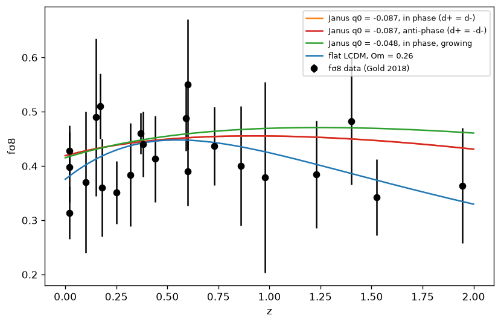
*Growth of structure, σ8 marginalised*

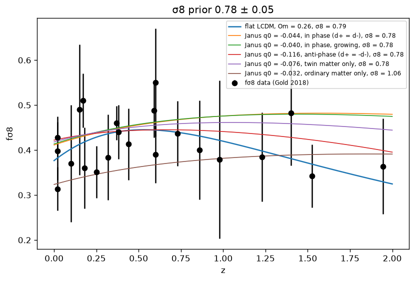
*Growth of structure with the σ8 prior 0.78 ± 0.05*

### Cosmic history and the earliest galaxies

| model | age today (Gyr) | dust era begins at | JWST galaxies at z = 10.6–14.4 |
|---|---|---|---|
| Flat ΛCDM | 13.79 | — | 0.29–0.44 Gyr after the big bang |
| Janus q0 = −0.087 | 16.45 (from z_start) | z = 5.75 | all predate the fitted solution |
| Janus q0 = −0.048 | 16.75 | z = 10.4 | all predate the fitted solution |
| Janus q0 = +0.085 | 14.25 | — | 0.41–0.61 Gyr |

Ages are not a problem for any variant. But at the published $q_0$ the fitted solution starts,
with H = 0 and the scale factor at its minimum, at z = 5.75: every known z > 6 galaxy and
quasar belongs to the model's unspecified radiative era. Starting before MoM-z14 ($z = 14.4$)
needs $|q_0| < 0.035$, just outside the growth window.

For Janus with $q_0 < 0$, 'age' counts from the start of the dust-era solution at
$z_{\rm start} = 1/(2|q_0|)$, where the scale factor is at its minimum; the model places an earlier
radiative era before that, with different physics, so galaxies at $z > z_{\rm start}$ fall outside the
solution that was fitted.

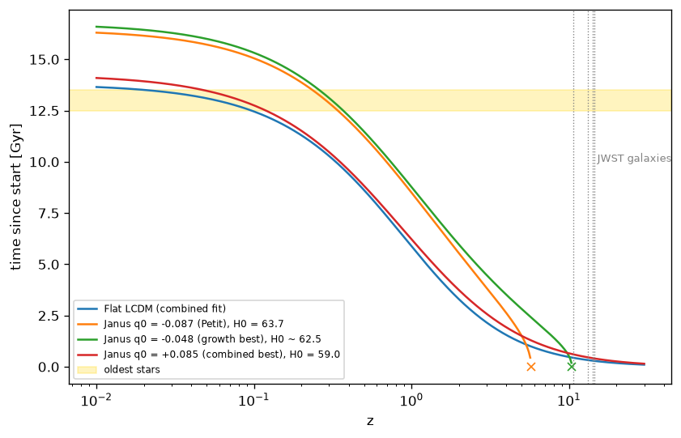
*Time since start of each solution vs redshift; JWST galaxies dotted, oldest stars shaded, crosses mark the Janus dust-era start*

### The q0 map

68% windows on the single Janus shape parameter from each probe: chronometers −0.075 to +0.100;
Pantheon+ −0.034 to −0.008; DES −0.040 to −0.015; BAO +0.098 to +0.104; combined +0.079 to
+0.091; growth −0.132 to −0.036; JWST −0.035 and above; the model's premise q0 < 0;
published −0.102 to −0.072. **No value of q0 satisfies supernovae and BAO together**, and the
intersection of all observational windows is empty. Under ΛCDM the same probes agree on Ω_m.

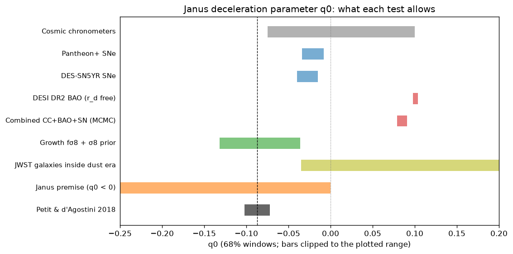
*68% windows on q0 from every test; dashed line at the published −0.087*

### A future test: redshift drift

Velocity drift of a fixed source per decade, cm/s, from

$$\dot v = c H_0\left[1 - \frac{E(z)}{1+z}\right] = c H_0\left[1 - \sqrt{1 + 2q_0 z}\right] \text{ (Janus)}:$$

| model | z = 2 | z = 3 | z = 4 | z = 5 |
|---|---|---|---|---|
| Flat ΛCDM | +0.11 | −2.55 | −5.10 | −7.47 |
| Janus q0 = −0.087 | +3.76 | +6.03 | +8.76 | +12.49 |
| Janus q0 = +0.085 | −2.85 | −4.14 | −5.36 | −6.51 |
| Milne | 0 | 0 | 0 | 0 |

The published Janus model and ΛCDM predict opposite signs across the ELT/ANDES Lyα-forest
range, separated by 9–20 cm/s per decade against a forecast precision of a few cm/s. This is a
clean, model-independent falsification route for the Janus expansion law.

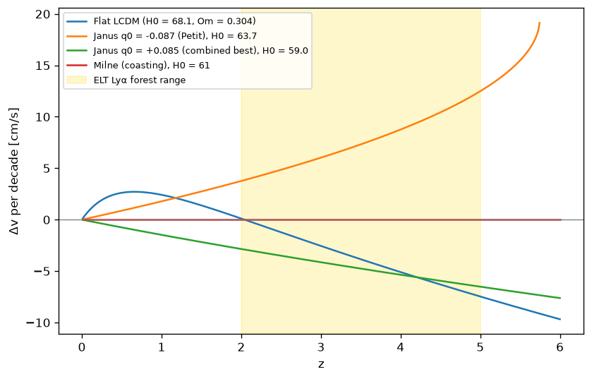
*Predicted redshift drift per decade; shaded band is the ELT/ANDES Lyα range*

### Standard sirens

Gravitational-wave sirens measure $D_L(z) = (1+z)\,\frac{c}{H_0}\,\frac{\sinh(\sqrt{\Omega_k}\,\chi)}{\sqrt{\Omega_k}}$,
$\chi = \int_0^z dz'/E(z')$, with no supernova calibration and no BAO ruler. Today they constrain
only $H_0$ (every model agrees on distance at z = 0.01):

| model | H0 needed to fit CC + BAO + SN | vs LVK GWTC-3, 68 (+8/−6) |
|---|---|---|
| Flat ΛCDM | 68.1 | 0.0σ |
| Janus q0 = −0.087 (published) | 63.7 | −0.7σ |
| Janus q0 = +0.085 (combined best) | 59.0 | −1.5σ |

At equal H0, the published Janus model predicts $D_L$ larger than ΛCDM by 4% at z = 1, 29% at
z = 2 and 66% at z = 3; the combined-best Janus is 7–8% *below* ΛCDM at z = 0.5–1. Einstein
Telescope / Cosmic Explorer neutron-star mergers with counterparts (few-percent $D_L$ per event,
reach z ~ 2–3) would therefore separate the expansion laws with a few dozen events, independent
of every systematic in the data used here.

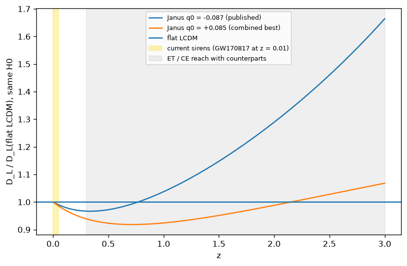
*Luminosity distance relative to flat ΛCDM at equal H0; current siren reach and ET/CE reach shaded*

### N-body code versus linear theory

The companion N-body simulations ran on a kinematic $a(t) \propto t^{2/3}$ background (not the Janus
one) with twin-to-ordinary density ratio 64, comoving equations $\ddot{\mathbf x} + 2H\dot{\mathbf x} = \mathbf g_c/a^3$,
seeded by Poisson shot noise of 4 × 10⁶ particles per population. That seed fixes the initial power
per mode to exactly $1/N$, so the linear two-fluid equations

$$\ddot\delta_\pm + 2H\dot\delta_\pm = \frac{4\pi G}{a^3}\left(\rho_\pm\,\delta_\pm - \rho_\mp\,\delta_\mp\right)$$

predict the absolute amplitude of the lowest box modes at all later times with no free parameter.
Measured from the long 3-D expansion run (`lss_20261017_015917`, 61 snapshots to t = 266 t_J):

- the growth *rate* matches: from t ≈ 40 to 266 t_J the scale factor grows 15-fold and the
  simulation/theory ratio stays constant to a few percent (0.37–0.39 twin, 0.42–0.46 ordinary);
- the mode structure matches: nearly equal |δ| in both populations, with ordinary matter growing
  although its own gravity is 64× weaker, i.e. the twin-driven cross-coupling behaves as written;
- the absolute amplitude is 2.5× below the pressureless prediction, fixed early and constant
  thereafter. Expansion switches on at $t_0 = 0.1\,t_J$ where $H \approx 30$ equals the twin instability
  rate $\sqrt{4\pi G\rho_-} \approx 28$, and the source drops 20-fold within ~16 timesteps; a switch-on
  transient of that size is the likely cause and would need a dt/4 rerun to confirm. Left as an
  open note.

Only the shape of the growth history enters the fits in this repository (σ8 marginalised or
given a prior), so the simulation confirms exactly the part of the growth equations that the
fits rely on, and the unvalidated part (absolute amplitude) is the part they never used.

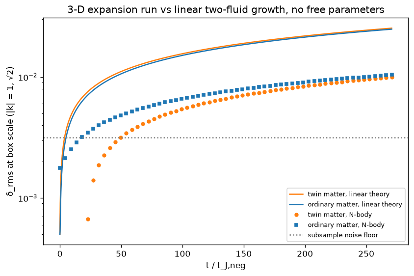
*Box-mode δ_rms in the 3-D expansion run against the linear two-fluid prediction*

### Closure test: can any twin sector rescue a no-dark-matter universe?

A general Friedmann background with ordinary matter fixed at the baryon density
($\Omega_b = 0.049$, no dark matter), curvature free, and a twin sector of free density
(either sign) and equation of state $w(a) = w_0 + w_a(1-a)$, fitted to CC + BAO + Pantheon+
with $r_d$ free (5 parameters vs 3 for flat ΛCDM), global optimiser:

| twin density | χ² | Δχ² vs flat ΛCDM | H0 | Ω_k | Ω_twin | w0 | wa | r_d |
|---|---|---|---|---|---|---|---|---|
| negative (Janus family, any w) | 1796.5 | +374 | 63.5 | 0.976 | −0.025 | 2.69 | −8.43 | 157.0 |
| positive | 1419.1 | −3.4 | 67.4 | 0.004 | 0.947 | −0.731 | 0.919 | 148.4 |
| free sign | 1419.1 | −3.4 | 67.4 | 0.004 | 0.947 | −0.731 | 0.919 | 148.4 |

- With negative density the optimiser drives the twin sector to zero: the best negative-density
  twin universe is the one with no twin matter, and it is worse than Janus's own best fit (which
  needed positive net matter).
- With positive density the best fit is ΛCDM in disguise: $w(z)$ runs from −0.73 today through
  −0.27 at $z = 1$ toward ≈ +0.2 at high $z$, exactly the effective equation of state of
  0.25 matter + 0.70 Λ, with H0, Ω_k and r_d at the ΛCDM values; two extra parameters buy
  Δχ² = −3.4 (AIC slightly worse than flat ΛCDM).

So the data do not merely disfavour Janus: given only baryons, they require ≈ 0.95 of additional
positively gravitating energy that behaves like matter early and like Λ late. No negative-density
sector with any equation of state can substitute for it.

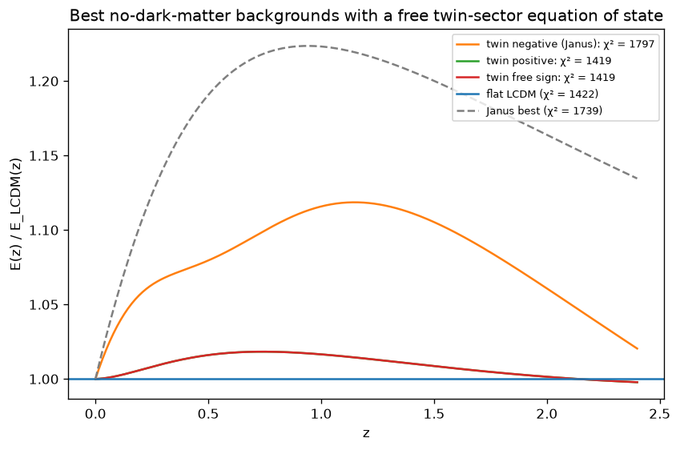
*Expansion rate relative to flat ΛCDM for the best no-dark-matter backgrounds*

## Conclusions

1. **The Janus expansion history, as published, is refuted by late-universe data** (BAO with
   free sound horizon, two independent supernova samples), with no early-universe assumptions,
   by Δχ² ≈ 317 against ΛCDM at equal parameter count, at a level no reasonable systematic
   could rescue. Stated per dataset, which is the fairer form when the probes disagree under a
   model: the published $q_0 = -0.087$ costs $\Delta\chi^2 = +22.6$ (Pantheon+) and $+22.8$ (DES)
   from supernovae alone — about $4.7\sigma$ each, with no BAO involved — and $+2158$ from DESI BAO
   alone. The combined-fit figures ($\Delta\chi^2 = 305$ for $q_0 < 0$, $2131$ for the published value)
   are nested one-parameter tests and formally valid, but once the datasets contradict each other
   within the model the combined error bar has no clean meaning; "overwhelming" is the honest
   word, and the per-probe numbers carry it.
2. **The model's defining claim fails within the model itself.** Negative net mass driving
   acceleration ($q_0 < 0$) is excluded; the only Janus background the data tolerate is
   decelerating, with positive net mass ≈ 0.17, more than three times the baryon density,
   i.e. it would need the dark matter the model removes. Curvature with a free Λ does not help
   (the data require Ω_Λ = 0.66 ± 0.03), and Janus worsens the Hubble tension about tenfold in χ².
3. **No value of $q_0$ satisfies all probes.** The 68% windows from supernovae and BAO are
   disjoint by ~0.1; the intersection of every observational window is empty.
4. **The twin-matter structure mechanism is not refuted.** Growth-rate data allow it at ≈ 1.9σ
   provided structure is seeded in the twin sector (the authors' own picture), with
   $q_0 \in [-0.13, -0.04]$ under a lensing σ8 prior; the companion N-body code reproduces the
   mechanism and its linear growth rate matches the equations used here. But that $q_0$ window is
   excluded by the expansion data: there is no $q_0$ at which Janus fits both.
5. **As a complete cosmology the model is unspecified.** At the published $q_0$ the fitted
   solution begins, static and at minimum size, at z = 5.75; every known z > 6 galaxy and
   quasar, including the whole JWST era, lies in a radiative-era model with varying constants
   for which no distance or growth predictions exist. Starting before the earliest confirmed
   galaxy (z = 14.4) needs $|q_0| < 0.035$, outside the growth window. Cosmic ages themselves are
   not a problem for any variant.
6. **Why the 2018 supernova fit looked good.** A χ²/dof below 1 is reached by almost any
   reasonable expansion history with supernova errors; the informative quantity is the
   comparison with ΛCDM on the same data and freedom, which the 2018 analysis did not make and
   which Janus loses by Δχ² ≈ 30–50 in each sample. The 2018 fit also took the light-curve
   calibration parameters ($M_B$, $\alpha$, $\beta$) from Betoule et al.'s ΛCDM fit rather than fitting or
   marginalising them (stated explicitly in §4 of that paper), and quotes no systematics covariance.
7. **Two clean future falsification routes exist that depend on none of the above data.**
   Redshift drift: the published Janus model and ΛCDM predict opposite signs at z ≈ 2–5,
   separated by 9–20 cm/s per decade against the ELT/ANDES target of a few cm/s. Standard
   sirens: $D_L$ differences of 4–66% at z = 1–3 at equal H0, against few-percent per-event
   precision expected from ET/CE.
8. **No rescue by a different twin sector.** With only baryons and a twin component of free
   density and equation of state, the negative-density family is driven to zero twin matter and
   fits worse than Janus itself; the positive-density family reconstructs ΛCDM's dark matter
   plus dark energy as a single fluid. The missing component must gravitate positively.

**Overall:** the Janus *mechanism* (twin matter shaping ordinary-matter structure) is
physically workable and partly reproduced in simulation; the Janus *universe* (the published
expansion history and its parameters) is not the one observed. What could change this verdict
is in the hands of the model's authors: a different background that fits BAO and supernovae
together, a specified early-universe model covering z > 6, or a perturbation theory of the
two-metric equations.

## Anticipated objections

Each of these has been raised, or would be, in defence of the model. The answers are in the
tables above; this section collects them.

**"DESI's BAO distances assume a fiducial ΛCDM cosmology, so they can't test a non-ΛCDM model."**
The published quantities are $D_M/r_d$ and $D_H/r_d$, obtained by multiplying measured dilation
parameters $\alpha_\perp, \alpha_\parallel$ by the fiducial distances; the fiducial dependence
cancels in the product to first order, and DESI tested the residual on mocks generated with
alternative cosmologies, finding a conservative systematic of 0.1% on both dilation parameters
(Pérez-Fernández et al. 2025, JCAP 01, 144). The Janus background differs from the fiducial by
more than those alternatives, so the residual could be larger — plausibly a few percent at most
at $z \sim 2$ through the Alcock–Paczynski template. The Janus distances miss DESI's by
20–40%. The chronometers and supernovae use no fiducial cosmology at all and reject the model
independently.

**"Janus does not describe recombination, so a comoving-constant acoustic scale is an assumption
imported from outside the model."** Correct, and the dependence should be explicit: the BAO test
assumes only that the acoustic feature — which is *observed* in the galaxy distribution at every
redshift DESI probes — kept a fixed comoving size between $z = 2.3$ and $z = 0.3$. That requires
nothing about its origin, only linear evolution during the dust era, which the Janus solution has
and which any FLRW-type expansion preserves (a 150 Mpc feature is deep in the linear regime, with
or without twin matter). For a varying ruler to rescue the fit it would have to change with
redshift in just the pattern that reproduces ΛCDM's distance shape; no mechanism in the model does
that and none has been proposed, and the model would then owe an account of why the peak sits where
DESI finds it. Independently of BAO, the supernovae alone reject the published $q_0$ at
$\approx 4.7\sigma$ in each sample and prefer ΛCDM by $\Delta\chi^2 = 30$–$50$.

**"The sound horizon $r_d$ is a ΛCDM quantity."** It is left free in every fit here (ΛCDM
recovers $r_d = 148 \pm 4$ Mpc with no CMB input; Janus prefers $\approx 154$ Mpc). Only the
*shape* of $D_M(z)$ and $D_H(z)$ is tested, which requires nothing from the early universe
except that an acoustic scale exists and is comoving-constant after recombination.

**"Supernova magnitudes are calibrated assuming ΛCDM."** The absolute magnitude is marginalised
analytically in every fit, and the full statistical + systematic covariance is used. This is
*more* freedom than the 2018 Janus fit allowed itself, which took $M_B, \alpha, \beta$ from the
ΛCDM analysis of Betoule et al. (stated in §4 of that paper). The light-curve standardisation
parameters $\alpha, \beta$ are not refitted here; their cosmology dependence is at the level of
hundredths of a magnitude, against residuals of tenths.

**"The test assumes an additive Friedmann equation, but Janus is bimetric."** The additive form
is the authors' own: the cross-coupling appears as $(a^{(-)}/a^{(+)})^3$ in eq. 1 of D'Agostini &
Petit (2018), and the conservation law $\rho c^2 a^3 + \bar\rho\bar c^2\bar a^3 = E$ is
eq. 96 of Petit, Margnat & Zejli (2024); together they give $E/a^3$ as the twin contribution,
independent of $\bar a(t)$. The only non-additive loophole — a non-dust twin sector — changes
the time dependence of that term but not its sign, and the closure test (baryons + curvature +
a twin sector of free density and free $w(a)$) drives every negative-density solution to zero.

**"χ² differences are not a proper model comparison."** At $\Delta\chi^2 \approx 317$ with
equal parameter counts, no information criterion or Bayesian-evidence computation changes
the conclusion; the AIC/BIC values are in the results files. More to the point, the decisive
statements are made *within* the Janus model, where no comparison statistic is needed:
$q_0 < 0$ and the published $q_0$ are excluded by nested one-parameter tests, per dataset and
combined, and the 68% windows from supernovae and from BAO do not overlap.

**"The radiative era / variable constants / the second metric explain the early universe."**
No prediction for distances, growth, or the CMB has been published from that era; the 2018
paper (§5) describes it as future work, and the 2026 Zenodo note (§6) still calls the CMB
proposal "the basic idea, which will require significant development work." A model with no
prediction for $z > 5.75$ cannot be rescued at $z > 5.75$. If such predictions appear, the
pipeline can test them in minutes.

**"DESI's result ('dark energy was more important in the past') confirms Janus's decreasing
acceleration" (Petit & D'Agostini, Zenodo, January 2026).** The note compares two
qualitative statements and no data. The histories are opposite where DESI measures: in the
DESI $w_0w_a$ fit (as in ΛCDM) the universe *decelerated* until $z \approx 0.7$ and accelerates
most strongly today ($q \approx -0.28$ now, $+0.1$ at $z = 1$); in Janus the acceleration is
strongest at the start of the dust era and there is never a decelerating epoch
($q = -0.09$ now, $-0.21$ at $z = 1$, diverging at $z = 5.75$). DESI's BAO lie at
$z = 0.3$–$2.3$, in the era where the two differ most, which is why they are the dataset that
rejects Janus hardest ($\chi^2 \approx 2389$ at $q_0 = -0.087$ vs $\approx 12$ for ΛCDM).

**"The growth data allow the mechanism."** They do, at $\approx 2\sigma$, for
$q_0 \in [-0.13, -0.04]$ — a window the expansion data exclude. A mechanism that works only in
a background the data forbid is not evidence for the model.

**"The authors' own tests: the dipole-repeller dimming ring and the EHT brightness-temperature
ratio ≈ 3."** These are the model's stated falsifiable predictions (2024 §13; 2026 note §4) and
are listed here as such; neither has been tested. They concern the negative-mass conglomerates,
not the expansion history, and would not change the background result either way.

## Caveats

- H(z) is derived here from the published $a(u) = \alpha^2 \cosh^2 u$ and confirmed against the
  authors' own distance formula and conservation law; the authors have been invited to confirm
  it is the expansion law they defend. If they propose a different background, the pipeline
  reruns directly.
- BAO assumes the acoustic scale is a fixed comoving ruler after recombination; a constant
  $r_d$ is free, but a redshift-dependent distortion by twin matter would need modelling (see
  Anticipated objections).
- Supernova distance moduli include bias corrections (selection, light-curve fitting) computed from
  simulations run in a ΛCDM reference cosmology; the residual model dependence is at the level of
  ~0.01 mag, against Janus residuals of tenths. Not refitted here.
- The chronometer fit treats Moresco's total errors as independent; the official covariance
  (gitlab mmoresco/CCcovariance) is not yet used. DESI cross-tracer correlations are not
  included (each tracer's own $D_M$–$D_H$ correlation is). Neither can affect a Δχ² of this size.
- The growth equations are the Newtonian linear limit of the interaction laws, not a
  perturbation theory of the two-metric field equations, which has not been published.
- Weak-lensing σ8 prior (0.78 ± 0.05) is a deliberately loose summary of DES Y3 / KiDS / HSC.
- The JWST cutoff uses MoM-z14 (z = 14.4); the growth-window edge at −0.036 vs the
  −0.035 limit is a near miss, not an exclusion.

## Sources

Janus model
- D'Agostini G., Petit J.-P. (2018), "Constraints on Janus Cosmological model from recent
  observations of supernovae type Ia", Astrophys. Space Sci. 363, 139, doi:10.1007/s10509-018-3365-3.
- Petit J.-P., D'Agostini G., Debergh N. (2019), "Physical and Mathematical Consistency of the
  Janus Cosmological Model (JCM)", Progress in Physics 15(1), 38–47.
- Petit J.-P., Margnat F., Zejli H. (2024), "A bimetric cosmological model based on Andreï
  Sakharov's twin universe approach", Eur. Phys. J. C 84, 1126, doi:10.1140/epjc/s10052-024-13569-w
  (arXiv:2412.04644) — current statement of the model; Sect. 10 gives the two-metric FLRW
  construction and the conservation law used above.
- Petit J.-P., D'Agostini G. (2015), "Lagrangian derivation of the two coupled field equations
  in the Janus cosmological model", Astrophys. Space Sci., doi:10.1007/s10509-015-2250-6.
- Petit J.-P., D'Agostini G. (2026), "The Janus Cosmological Model predicted a law of expansion
  with variable acceleration as early as 2014", Zenodo, doi:10.5281/zenodo.18368285 (not peer-reviewed).
- Damour T. (2019), "Sur le 'modèle Janus' de J. P. Petit", IHES note (theoretical consistency critique).

Data
- Cosmic chronometers: Moresco M. et al. (2012) JCAP 08, 006; Moresco M. (2015) MNRAS 450,
  L16; Moresco M. et al. (2016) JCAP 05, 014; covariance: Moresco et al. (2020) ApJ 898, 82,
  gitlab.com/mmoresco/CCcovariance.
- DESI DR2 BAO: Abdul Karim M. et al. (DESI Collaboration) (2025) Phys. Rev. D 112, 083515;
  values as tabulated in arXiv:2604.11106, Table 2. Fiducial-cosmology systematics:
  Pérez-Fernández A. et al. (2025) JCAP 01, 144.
- Pantheon+: Scolnic D. et al. (2022) ApJ 938, 113; Brout D. et al. (2022) ApJ 938, 110;
  github.com/PantheonPlusSH0ES/DataRelease.
- SH0ES: Riess A. G. et al. (2022) ApJL 934, L7.
- DES-SN5YR: DES Collaboration (2024) ApJL 973, L14; Dovekie recalibration (2025);
  github.com/des-science/DES-SN5YR.
- Growth rate compilation: Sagredo B., Nesseris S., Sapone D. (2018) Phys. Rev. D 98, 083543
  (arXiv:1806.10822), Table I.
- JWST galaxies: GN-z11, Bunker A. J. et al. (2023); JADES-GS-z13-0, Curtis-Lake E. et al.
  (2023) Nat. Astron. 7, 622; JADES-GS-z14-0, Carniani S. et al. (2024) Nature 633, 318;
  MoM-z14, Naidu R. P. et al. (2025).
- Redshift drift: Sandage A. (1962) ApJ 136, 319; Loeb A. (1998) ApJL 499, L111; Liske J.
  et al. (2008) MNRAS 386, 1192; ELT/ANDES science case.
- Standard sirens: Abbott B. P. et al. (LVC) (2017) Nature 551, 85 (GW170817 H0);
  Abbott R. et al. (LVK) (2023) ApJ 949, 76 (GWTC-3 cosmology); Einstein Telescope and
  Cosmic Explorer science cases.
- Companion N-body project: see the simulation repository linked in the GitHub sidebar.
