# Janus background fits

Tests of the Janus cosmological model (Petit & d'Agostini) against late-universe data:
cosmic chronometers, DESI DR2 BAO, two supernova samples, SH0ES-calibrated supernovae and
redshift-space-distortion growth measurements. All fits are compared with flat ΛCDM on the same
data with the same number of free parameters. No early-universe assumptions are made anywhere:
the BAO sound horizon r_d and the supernova absolute magnitude are left free, so only the
*shape* of the expansion history is tested.

Companion project: N-body simulations of the Janus twin-matter dynamics (see the simulation
repository linked in the GitHub sidebar).

## The model being tested

The Janus dust-era exact solution is a(u) = α² ch²(u) on an open (k = −1) universe
(Petit & d'Agostini 2018; same form in the 2023 and 2024 papers). From it,

    H(z) = H0 (1 + z) sqrt(1 + 2 q0 z),      Ω_m = 2 q0,   Ω_k = 1 − 2 q0,

with the published value q0 = −0.087 ± 0.015. This is verified analytically here against the
authors' own distance formula r = sh(2u0 − 2u_e), so the fits test the model exactly as its
authors define it. The solution is defined only for 1 + 2 q0 z > 0, i.e. z < 1/(2|q0|) when
q0 < 0 (z = 5.75 for the published value); the scale factor reaches a minimum there, and the
model assigns earlier epochs to a separate radiative-era solution that is not tested here.

Note that the Janus background is mathematically identical to a universe containing only
matter and curvature with no cosmological constant and a matter density allowed to be
negative. Fitting Janus with q0 free therefore tests that entire family.

## Scripts

| script | data | what it does |
|---|---|---|
| `cc_fit.py` | 15 cosmic chronometers | H(z) fit, Janus / ΛCDM / Milne, q0 profile |
| `bao_fit.py` | DESI DR2 BAO (13 points) | D_M/r_d, D_H/r_d, D_V/r_d with r_d free |
| `sn_fit.py` | Pantheon+ (1590 SNe, z > 0.01) | full STAT+SYS covariance, magnitude marginalised |
| `des_fit.py` | DES-SN5YR Dovekie (1820 SNe) | same method, inverse covariance from DES release |
| `likelihoods.py` | all of the above | shared likelihood module |
| `combined_fit.py [des]` | CC + BAO + SN | best fits, AIC/BIC, emcee posteriors, corner plots; Janus, flat ΛCDM, oΛCDM |
| `premise_test.py` | CC + BAO + SN | Δχ² of q0 = 0 and q0 = −0.087 within the Janus model |
| `h0_test.py` | Pantheon+ with SH0ES Cepheid calibrators | absolute H0; cost of combining with BAO + CC |
| `growth_fit.py` | 22 fσ8 points (Gold 2018) | two-fluid linear growth, σ8 marginalised |
| `growth_fixed_amp.py` | same | σ8 with a weak-lensing-style prior 0.78 ± 0.05 |
| `first_galaxies.py` | — | cosmic ages, start of the Janus dust era vs JWST galaxies |
| `q0_map.py` | — | allowed q0 window from every test on one axis |
| `redshift_drift.py` | — | predicted redshift drift for ELT/ANDES |

Outputs (tables and plots) are in `results/`.

### Reproducing

Python ≥ 3.10 with numpy, scipy, matplotlib, emcee, corner, tqdm.

    mkdir -p data && cd data
    wget https://raw.githubusercontent.com/PantheonPlusSH0ES/DataRelease/main/Pantheon%2B_Data/4_DISTANCES_AND_COVAR/Pantheon%2BSH0ES.dat
    wget https://raw.githubusercontent.com/PantheonPlusSH0ES/DataRelease/main/Pantheon%2B_Data/4_DISTANCES_AND_COVAR/Pantheon%2BSH0ES_STAT%2BSYS.cov
    git clone --depth 1 --filter=blob:none --sparse https://github.com/des-science/DES-SN5YR.git des_repo
    (cd des_repo && git sparse-checkout set 4_DISTANCES_COVMAT)
    cd ..
    for s in cc_fit bao_fit sn_fit des_fit premise_test h0_test growth_fit growth_fixed_amp first_galaxies q0_map redshift_drift; do python $s.py; done
    python combined_fit.py; python combined_fit.py des

The chronometer and BAO tables are embedded in the scripts. The combined fits take a few
minutes each (MCMC over the full supernova covariance).

### Validation

Every likelihood reproduces a published ΛCDM result before being applied to Janus:

| test | this pipeline | published |
|---|---|---|
| DESI DR2 BAO, flat ΛCDM | Ω_m = 0.297, H0·r_d ≈ 10 150 km/s | Ω_m ≈ 0.2975, h·r_d ≈ 101.5 Mpc |
| Pantheon+, flat ΛCDM | Ω_m = 0.332 | ≈ 0.33 |
| DES-SN5YR Dovekie, flat ΛCDM | Ω_m = 0.330 | ≈ 0.30–0.35 |
| Combined, flat ΛCDM, r_d free | r_d = 148.2 ± 4.1 Mpc with no CMB input | ≈ 147 Mpc from CMB physics |
| Pantheon+ with SH0ES calibrators | H0 = 73.5 | 73.6 (SH0ES) |
| Gold fσ8, flat ΛCDM | Ω_m = 0.256, σ8 = 0.80, χ² = 12.2/20 | the usual growth-only values |
| Age of a flat ΛCDM universe | 13.79 Gyr; 0.29 Gyr at z = 14.2 | 13.8 Gyr |

## Results

### Expansion history

| data | Δχ² (best Janus − best flat ΛCDM), equal parameters | best Janus q0 | Petit's q0 = −0.087 |
|---|---|---|---|
| Cosmic chronometers (15) | +1.6 | 0.005 (−0.075 to 0.100) | Δχ² +1.3 from best |
| DESI DR2 BAO (13), r_d free | **+221** | +0.101 (0.098 to 0.104) | χ² = 2389 (Δ +2158) |
| Pantheon+ (1590) | **+46.5** | −0.022 (−0.034 to −0.008) | Δ +22.6 |
| DES-SN5YR (1820) | **+29.3** | −0.027 (−0.040 to −0.015) | Δ +22.8 |
| Combined CC+BAO+Pantheon+ | **+316.6** | +0.085 ± 0.006, H0 = 58.9 ± 1.6, r_d = 154.5 ± 4.3 | Δ +2131 (≈ 46σ) |
| Combined CC+BAO+DES | **+317.1** | +0.081 ± 0.006, H0 = 59.0 ± 1.6, r_d = 154.7 ± 4.3 | — |

- Within the Janus model itself, q0 = 0 (zero net mass) is excluded at Δχ² = 305 (≈ 17σ) and
  the published q0 = −0.087 at Δχ² = 2131. The only Janus background the data tolerate at all
  is *decelerating*, with positive net mass Ω_m = 2q0 ≈ 0.17, more than three times the
  baryon density; i.e. it would require dark matter, which the model exists to remove.
- Under Janus the datasets disagree with each other (supernovae want q0 ≈ −0.02, BAO wants
  +0.10). Under ΛCDM the same datasets agree.
- With curvature and Λ both free (oΛCDM), the data require Ω_Λ = 0.66 ± 0.03 and near-flatness;
  curvature does not substitute for dark energy.
- SH0ES-calibrated supernovae give H0 ≈ 72–73 in both models; reconciling that with BAO + CC
  costs χ² = 26.5 in ΛCDM (the known Hubble tension) and 334 in Janus.

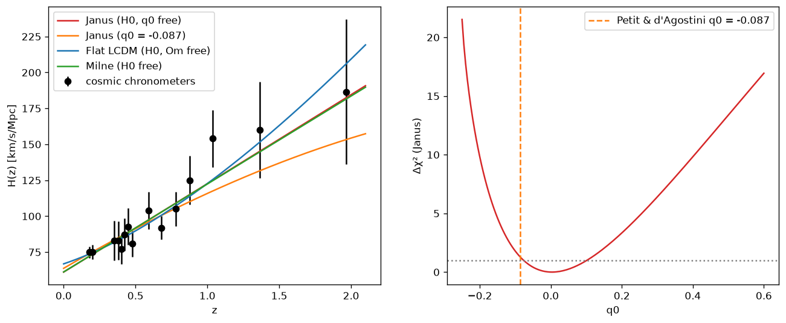
*Cosmic chronometers: H(z) with the four models (left); Janus χ² profile in q0 (right)*

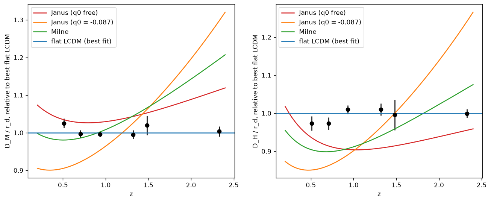
*DESI DR2 BAO: D_M/r_d and D_H/r_d relative to best flat ΛCDM, with Janus and Milne*

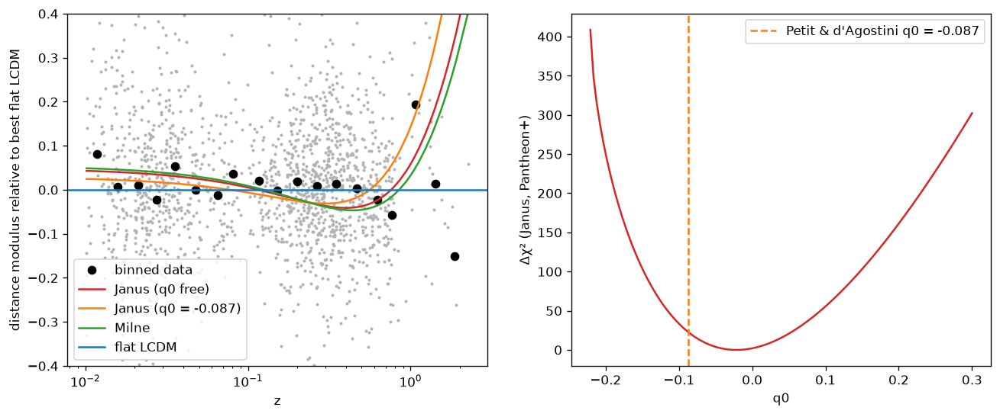
*Pantheon+: residuals relative to best flat ΛCDM (left); Janus q0 profile (right)*

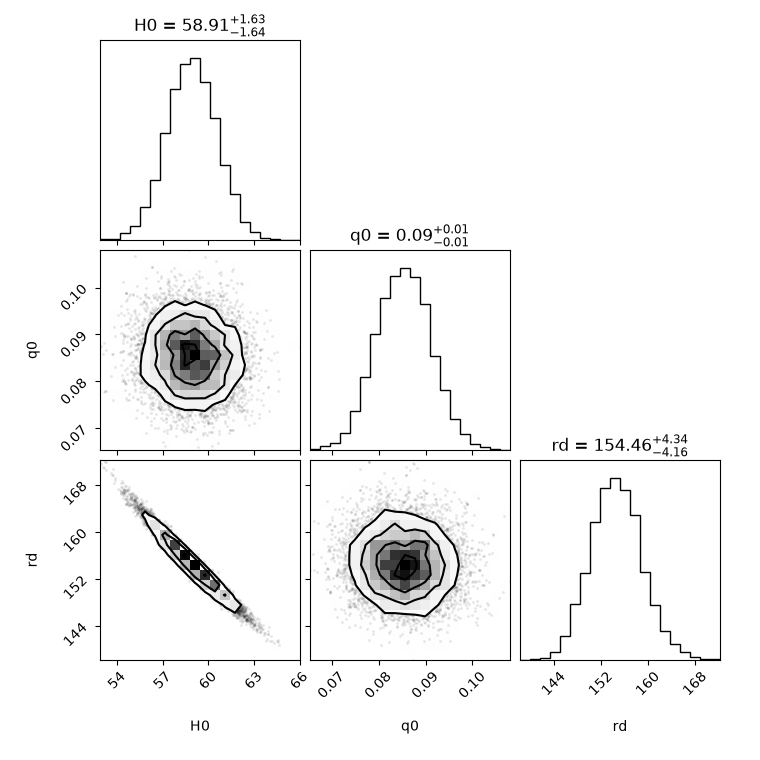
*Combined CC + BAO + Pantheon+: Janus posterior*

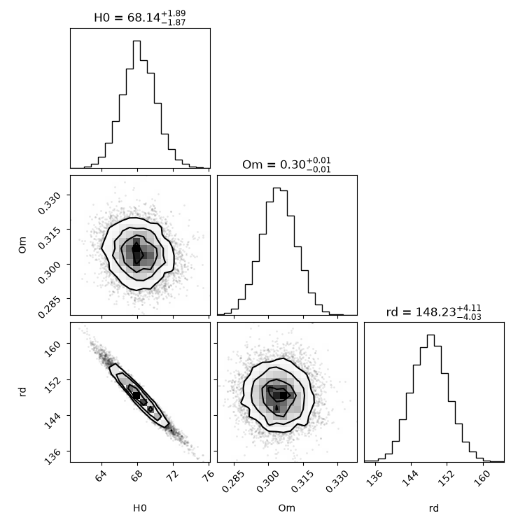
*Combined CC + BAO + Pantheon+: flat ΛCDM posterior*

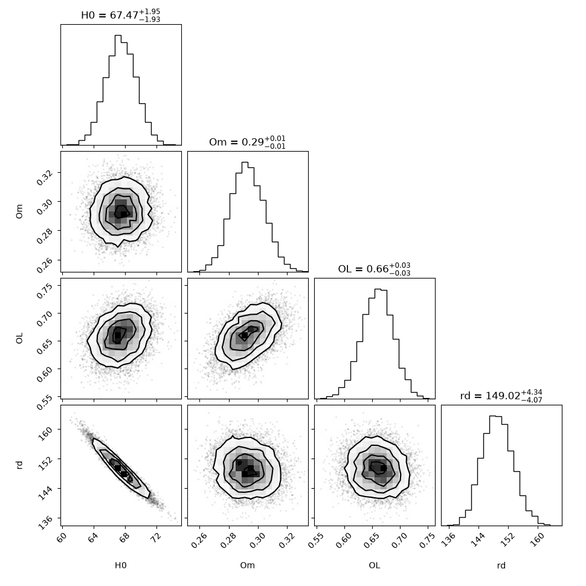
*Combined CC + BAO + Pantheon+: oΛCDM posterior*

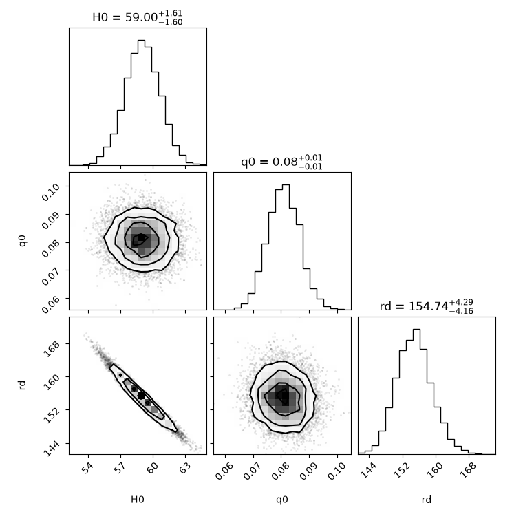
*Combined CC + BAO + DES-SN5YR: Janus posterior*

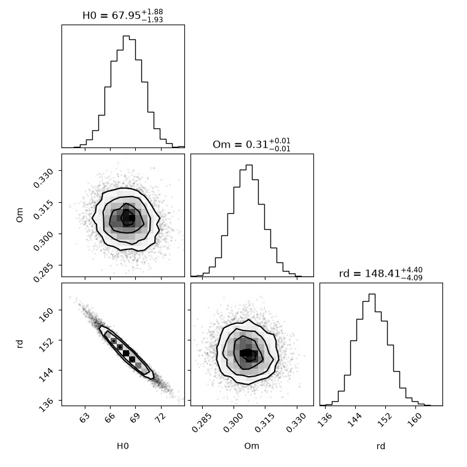
*Combined CC + BAO + DES-SN5YR: flat ΛCDM posterior*

*Combined CC + BAO + DES-SN5YR: oΛCDM posterior*

### Growth of structure

Linear Newtonian two-fluid equations from the three Janus interaction laws (like attracts like,
unlike repels), on the Janus background, with ordinary matter = baryons (Ω+ = 0.049) and
twin matter fixed by the background (Ω− = Ω+ − 2q0). Galaxies trace ordinary matter.

| | χ² (22 points) | Δχ² vs ΛCDM |
|---|---|---|
| Flat ΛCDM | 12.2 | — |
| Janus, σ8 free, best over q0 and starting conditions | 15.8 | +3.5 (≈ 1.9σ) |
| Janus, σ8 prior 0.78 ± 0.05, best | 15.8 (q0 = −0.040) | +3.5 |
| Janus, q0 = −0.087, σ8 prior, twin-seeded start | 16.9 | +4.6 |
| Janus, q0 = −0.087, σ8 prior, ordinary-matter-seeded start | 46–120 | excluded |

The growth mechanism is **not rejected**: with structure seeded in the twin sector (the authors'
own picture, and what the companion N-body runs show) the fσ8 shape is close to ΛCDM, because
the dominant growing mode is driven by Ω+ + Ω− ≈ 0.27. But it works only for
q0 ∈ [−0.13, −0.04] (68%), a window the expansion data exclude at > 17σ.

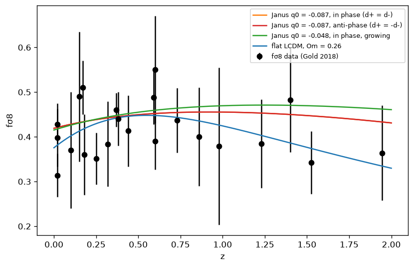
*Growth of structure, σ8 marginalised*

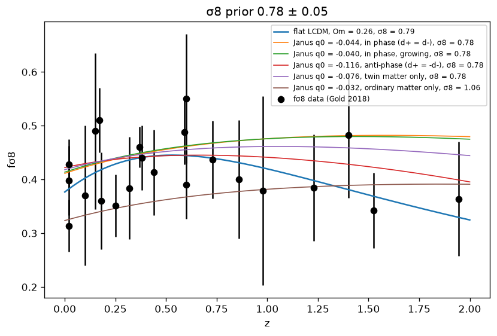
*Growth of structure with the σ8 prior 0.78 ± 0.05*

### Cosmic history and the earliest galaxies

| model | age today (Gyr) | dust era begins at | JWST galaxies at z = 10.6–14.4 |
|---|---|---|---|
| Flat ΛCDM | 13.79 | — | 0.29–0.44 Gyr after the big bang |
| Janus q0 = −0.087 | 16.45 (from z_start) | z = 5.75 | all predate the fitted solution |
| Janus q0 = −0.048 | 16.75 | z = 10.4 | all predate the fitted solution |
| Janus q0 = +0.085 | 14.25 | — | 0.41–0.61 Gyr |

Ages are not a problem for any variant. But at the published q0 the fitted solution starts,
with H = 0 and the scale factor at its minimum, at z = 5.75: every known z > 6 galaxy and
quasar belongs to the model's unspecified radiative era. Starting before MoM-z14 (z = 14.4)
needs |q0| < 0.035, just outside the growth window.

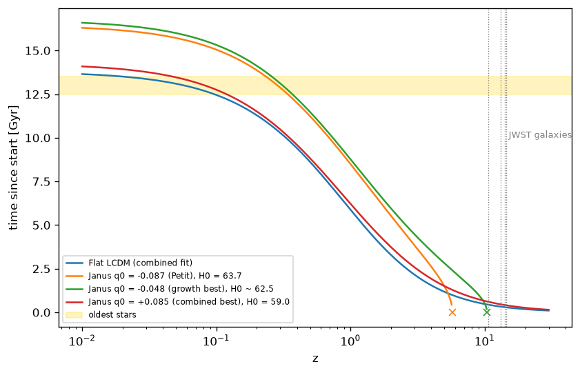
*Time since start of each solution vs redshift; JWST galaxies dotted, oldest stars shaded, crosses mark the Janus dust-era start*

### The q0 map (`results/q0_map.png`)

68% windows on the single Janus shape parameter from each probe: chronometers −0.075 to +0.100;
Pantheon+ −0.034 to −0.008; DES −0.040 to −0.015; BAO +0.098 to +0.104; combined +0.079 to
+0.091; growth −0.132 to −0.036; JWST −0.035 and above; the model's premise q0 < 0;
published −0.102 to −0.072. **No value of q0 satisfies supernovae and BAO together**, and the
intersection of all observational windows is empty. Under ΛCDM the same probes agree on Ω_m.

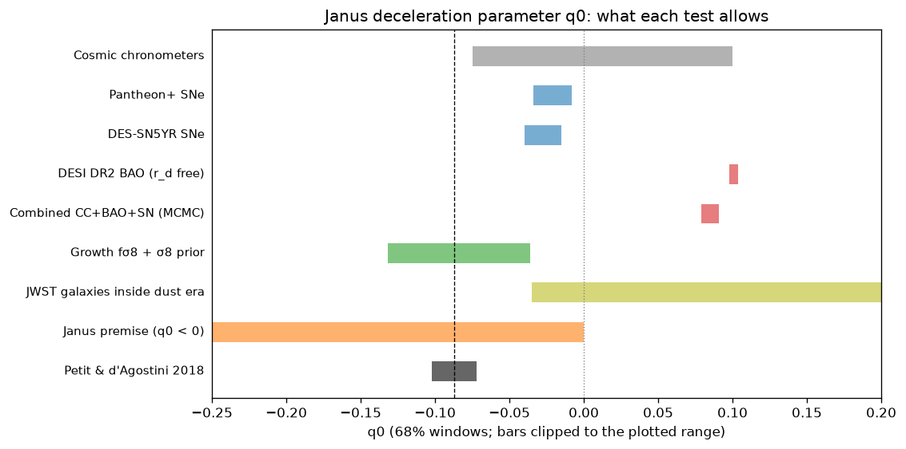
*68% windows on q0 from every test; dashed line at the published −0.087*

### A future test: redshift drift (`results/redshift_drift.png`)

Velocity drift of a fixed source per decade, cm/s:

| model | z = 2 | z = 3 | z = 4 | z = 5 |
|---|---|---|---|---|
| Flat ΛCDM | +0.11 | −2.55 | −5.10 | −7.47 |
| Janus q0 = −0.087 | +3.76 | +6.03 | +8.76 | +12.49 |
| Janus q0 = +0.085 | −2.85 | −4.14 | −5.36 | −6.51 |
| Milne | 0 | 0 | 0 | 0 |

The published Janus model and ΛCDM predict opposite signs across the ELT/ANDES Lyα-forest
range, separated by 9–20 cm/s per decade against a forecast precision of a few cm/s. This is a
clean, model-independent falsification route for the Janus expansion law.

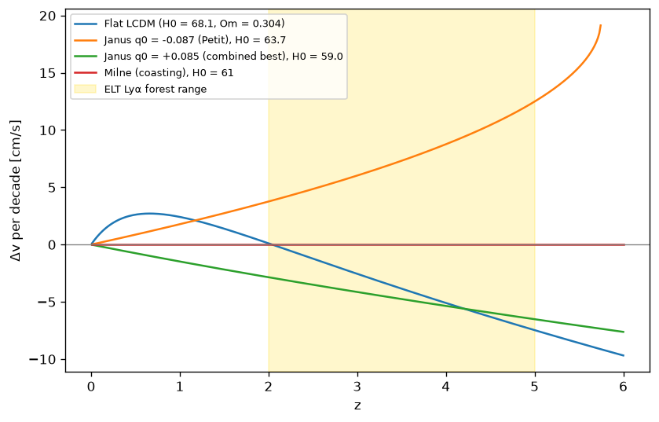
*Predicted redshift drift per decade; shaded band is the ELT/ANDES Lyα range*

## Conclusions

1. **The Janus expansion history, as published, is refuted by late-universe data** (BAO with
   free sound horizon, two independent supernova samples), with no early-universe assumptions,
   by Δχ² ≈ 317 against ΛCDM at equal parameter count. The model's defining feature, an
   accelerating universe with negative net mass (q0 < 0), is excluded at ≈ 17σ within the model
   itself; the published q0 = −0.087 at ≈ 46σ.
2. **The twin-matter structure-formation mechanism is not refuted** by growth-rate data, but
   only in a q0 window the expansion data exclude. There is no q0 at which Janus fits both.
3. **As a complete cosmology the model is unspecified**: at the published q0 everything before
   z ≈ 5.7, including the whole JWST era, lies outside the solution that was fitted, in a
   radiative-era model with varying constants for which no distance or growth predictions exist.
4. **Why the 2018 supernova fit looked good:** a χ²/dof below 1 is reached by almost any
   reasonable expansion history with supernova errors; the informative quantity is the
   comparison with ΛCDM on the same data and freedom, which the 2018 analysis did not make,
   and which Janus loses by Δχ² ≈ 30–50 in each sample. The 2018 fit also used light-curve
   calibration from the ΛCDM fit rather than fitting or marginalising it.

## Caveats

- H(z) is derived here from the published a(u) = α² ch²(u); the authors have not been asked
  to confirm it is the expansion law they defend. If they propose a different background, the
  pipeline reruns directly.
- BAO assumes the acoustic scale is a fixed comoving ruler after recombination; a constant
  r_d is free, but a redshift-dependent distortion by twin matter would need modelling.
- The chronometer fit treats Moresco's total errors as independent; the official covariance
  (gitlab mmoresco/CCcovariance) is not yet used. DESI cross-tracer correlations are not
  included (each tracer's own D_M–D_H correlation is). Neither can affect a Δχ² of this size.
- The growth equations are the Newtonian linear limit of the interaction laws, not a
  perturbation theory of the two-metric field equations, which has not been published.
- Weak-lensing σ8 prior (0.78 ± 0.05) is a deliberately loose summary of DES Y3 / KiDS / HSC.
- The JWST cutoff uses MoM-z14 (z = 14.4); the growth-window edge at −0.036 vs the
  −0.035 limit is a near miss, not an exclusion.

## Sources

Janus model
- Petit J.-P., d'Agostini G. (2018), "Constraints on Janus cosmological model from recent
  observations of supernovae type Ia", Astrophys. Space Sci. 363, 139.
- Petit J.-P., Margnat F., Zejli H. (2024), Eur. Phys. J. C — current statement of the model
  (check volume/article number).
- The 2023 consistency paper giving a(+) = (4πGρ0/3c²) ch²(v) (add reference).

Data
- Cosmic chronometers: Moresco M. et al. (2012) JCAP 08, 006; Moresco M. (2015) MNRAS 450,
  L16; Moresco M. et al. (2016) JCAP 05, 014; covariance: Moresco et al. (2020) ApJ 898, 82,
  gitlab.com/mmoresco/CCcovariance.
- DESI DR2 BAO: Abdul Karim M. et al. (DESI Collaboration) (2025) Phys. Rev. D 112, 083515;
  values as tabulated in arXiv:2604.11106, Table 2.
- Pantheon+: Scolnic D. et al. (2022) ApJ 938, 113; Brout D. et al. (2022) ApJ 938, 110;
  github.com/PantheonPlusSH0ES/DataRelease.
- SH0ES: Riess A. G. et al. (2022) ApJL 934, L7.
- DES-SN5YR: DES Collaboration (2024) ApJL 973, L14; Dovekie recalibration (2025);
  github.com/des-science/DES-SN5YR.
- Growth rate compilation: Sagredo B., Nesseris S., Sapone D. (2018) Phys. Rev. D 98, 083543
  (arXiv:1806.10822), Table I.
- JWST galaxies: GN-z11, Bunker A. J. et al. (2023); JADES-GS-z13-0, Curtis-Lake E. et al.
  (2023) Nat. Astron. 7, 622; JADES-GS-z14-0, Carniani S. et al. (2024) Nature 633, 318;
  MoM-z14, Naidu R. P. et al. (2025).
- Redshift drift: Sandage A. (1962) ApJ 136, 319; Loeb A. (1998) ApJL 499, L111; Liske J.
  et al. (2008) MNRAS 386, 1192; ELT/ANDES science case.
